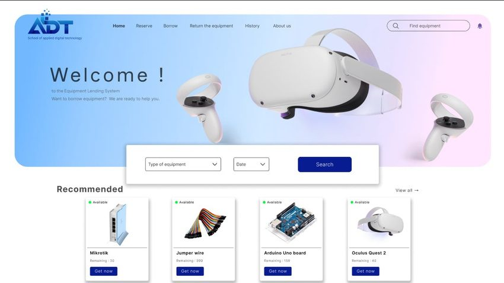

# ADT Web Design

Responsive website interface designed in Figma and built in HTML and CSS.

## Links

- **Live site:** https://tanatep-thewgo.github.io/ADT-web-test/
- **Figma prototype:** [Open the clickable prototype](https://www.figma.com/proto/5XdHMakxD1wf58hPr3PqZ3/Untitled?node-id=1-3&t=2wgtDc7m1pOZhFEg-1&scaling=contain&content-scaling=fixed&page-id=0%3A1&starting-point-node-id=1%3A3)

## What I did

- Designed the page layouts and user flow in Figma, from wireframe to clickable prototype.
- Built the pages in HTML and CSS: login page, account recovery and sign-up, and a product page.
- Kept the layout responsive so it works on desktop and mobile.

## Built with

Figma · HTML · CSS

## Author

Thanatep Pamuta · [Portfolio](https://tanatep-thewgo.github.io/) · [GitHub](https://github.com/tanatep-thewgo)
